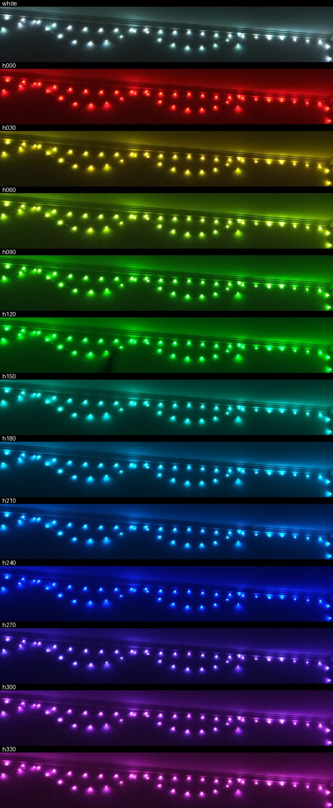
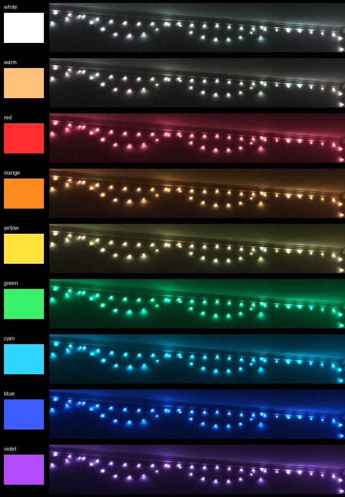
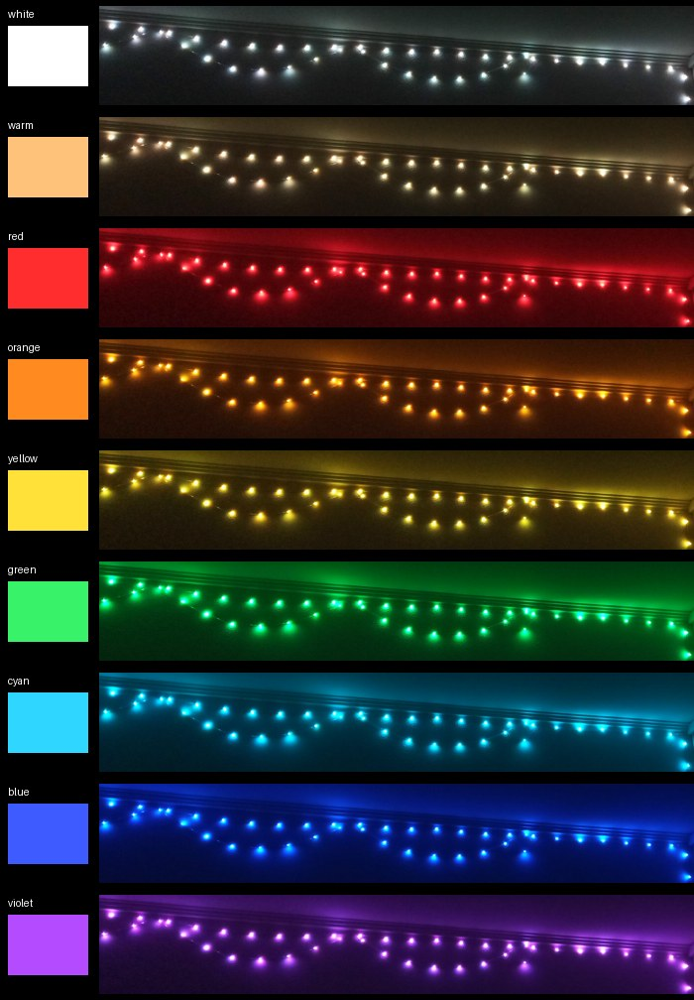

# Colour correction

Send the garland a colour as plain hue and saturation and it shows something else. The green and blue LEDs are strong
for the red, and the controller drives its channels linearly. Three fixes, all in
[reference/mrstar.py](reference/mrstar.py):

## 1. Hue

We sent every 30° of hue at full saturation and brightness, photographed the garland each time (see
[METHOD.md](METHOD.md)), and read the hue of its light on a white wall:

| sent | 0 | 30 | 60 | 90 | 120 | 150 | 180 | 210 | 240 | 270 | 300 | 330 |
|---|---|---|---|---|---|---|---|---|---|---|---|---|
| seen | 358 | **52** | **82** | **116** | 123 | **175** | **200** | 215 | 237 | **253** | **275** | **300** |

Orange (30) comes out yellow, yellow comes out lime, and purples slide towards blue. The fix sends the inverse of this
curve, interpolated linearly: to show 30° we send ~17°, to show 300° we send ~330°. A second series shot with the
correction landed every hue within **6°** of the one asked for; uncorrected, it was off by up to 30°.

## 2. Saturation

The strip lights its weaker channels at `1 - s` of full, linearly. A screen colour's channels are gamma-encoded, so a
pale screen colour sent as is washes out on the garland: `#ff2d2d` (saturation 0.82) came out pink, and `#ffe13a`
nearly white. Sending `1 - (1 - s) ** 2.2` instead brings them back.

Hue correction only (red is pink, yellow and warm white are near white):

Hue and saturation corrected:

## 3. White

Saturation 0 is a cold cyan. Hue 0 at saturation 270, which is red full and green and blue at 0.73, reads as neutral to
the camera. Paler colours get a share of that fix in proportion to how unsaturated they are.

## Effects can't be corrected

The effects are generated inside the controller, so their colours are what they are. A drawing of them should use the
colours as they look: [reference/effects.js](reference/effects.js) draws orange as warm yellow and yellow as lime, and
runs its smooth rainbows through the measured curve above.
