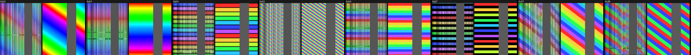
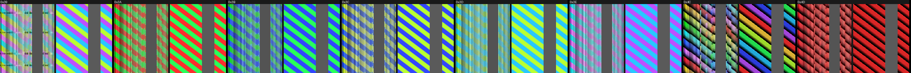
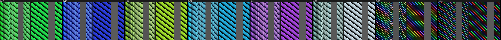
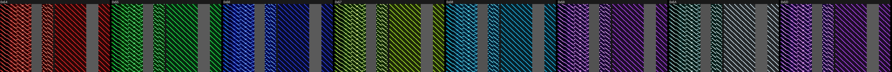
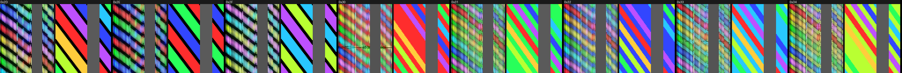
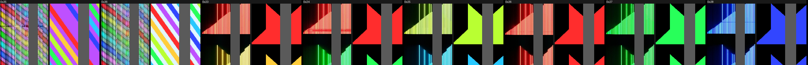
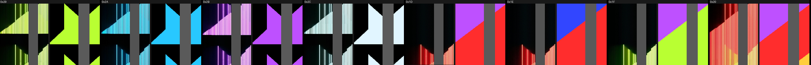
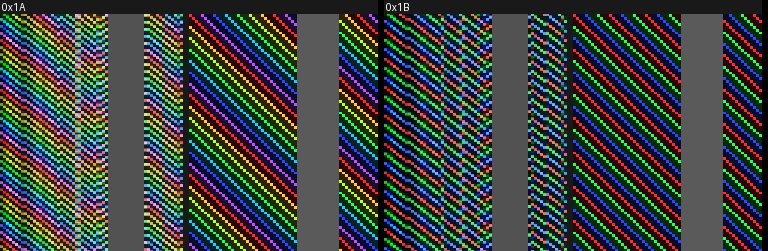

# mrstar-ble-notes

Notes from driving a cheap **MR Star** (FINDN) Bluetooth LED garland from our own code: what its 58 effects really
look like, a colour correction for its strong greens, and a small Android app that puts any BLE device on HTTP. A
phone camera was used to measure it all.

The garland is the kind sold as "RGB fairy lights / bead string" with the **MR Star** app. It advertises as
`GATT--DEMO` and takes commands on characteristic `FFF3`. Ours has about 65 frosted beads.

## What's here

| | |
| --- | --- |
| [EFFECTS.md](EFFECTS.md) | All 58 effects as the garland really plays them: colours, pattern, step, speed, cycle. Several don't match their usual names. |
| [COLOR.md](COLOR.md) | How far off its colours are, and the correction that brings every hue within 6° of the one asked for. |
| [METHOD.md](METHOD.md) | How it was measured: a phone on a stand, locked white balance, 30 fps bursts, reading every bead. |
| [reference/mrstar.py](reference/mrstar.py) | Command bytes and the colour correction, in plain Python. |
| [reference/effects.js](reference/effects.js) | A drawing model of every effect (`frame(effect, beads, t, out)`), fitted to the films. |
| [bridge/](bridge) | **BLE Bridge**, an Android app (no root, no dependencies) that exposes a BLE device over HTTP on the phone; it can also take photos and frame bursts. |
| [tools/burst.py](tools/burst.py) | Splits a `/burst` response into frames. |

## Protocol

Everything is written to `FFF3` (service `FFF0`), write without response. The controller never answers, so its
state is whatever you last told it.

| Command | Bytes |
| --- | --- |
| on / off | `BC 01 01 01 55` / `BC 01 01 00 55` |
| colour | `BC 04 06` hue (0..359, 2 bytes) saturation (0..1000, 2 bytes) `00 00 55` |
| brightness | `BC 05 06` value (1..1000, 2 bytes) `00 00 00 00 55` |
| effect | `BC 06 02 00 <number> 55` (numbers in [EFFECTS.md](EFFECTS.md)) |
| direction | `BC 07 01 <01 away from the controller / 00 towards it> 55` |
| effect speed | `BC 08 01 <1..100> 55`, higher is faster |

A colour command stops a running effect. The controller takes one connection at a time: while your code holds it,
the phone app can't connect.

Credits: the bytes are from [hirotasoshu/ha-findn-led-ble](https://github.com/hirotasoshu/ha-findn-led-ble), and speed
from [nukemberg/cheap-leds](https://github.com/nukemberg/cheap-leds) and [jeanpfs/lumen](https://github.com/jeanpfs/lumen).
We checked all of them on our garland.

## What we found

- **Its "7 colours" are the rainbow**, red orange yellow green cyan blue purple. On the garland the orange looks like
  a warm yellow and the yellow looks lime.
- **Patterns repeat along the strip** and run away from the controller. "Tailing" is a comet every 13 beads, not one
  comet. "Running" is a bright bead every 6, "fluttering" every 4, and "water" is blocks of 8.
- **Some names are wrong for this hardware.** The ten "light-dark transition" effects (0x2D–0x36) don't fade at
  all: 0x2D–0x2F are moving colour bands, and 0x30–0x36 run the rainbow over a background colour. 0x5D
  "purple-cyan-yellow running" is purple only. Two "running water" effects use cyan where the name says green or blue.
- **Colours need correcting.** Hue 30 (orange) shows as yellow and 300 (purple) as violet; pale colours wash out
  towards white, and white is cyan. See [COLOR.md](COLOR.md).

## The films

Each image puts the filmed garland (left of each pair) next to the model in `effects.js` (right). Columns are beads
in wire order from the controller, time runs down (8 s, 30 frames a second). The grey block is the ~14 beads the
camera could not see, kept in place so a running pattern stays a straight line across them.

## License

MIT, see [LICENSE](LICENSE).
